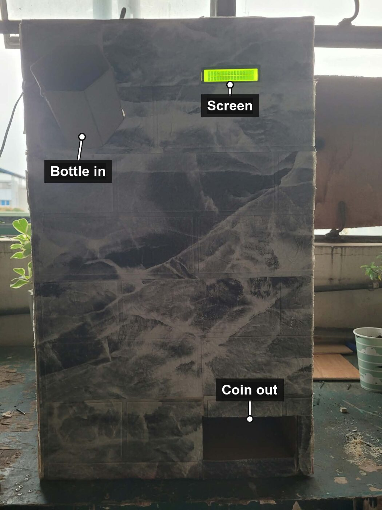
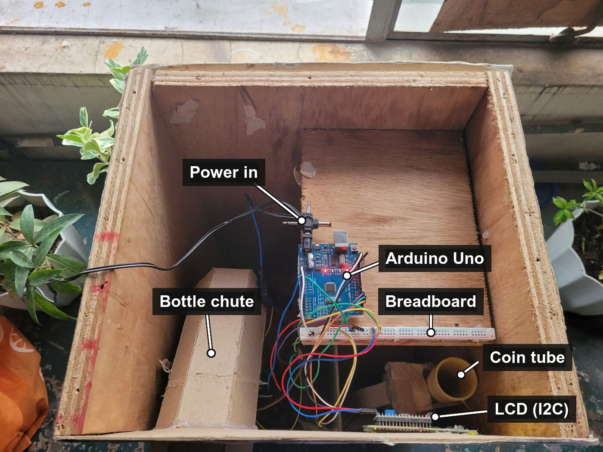
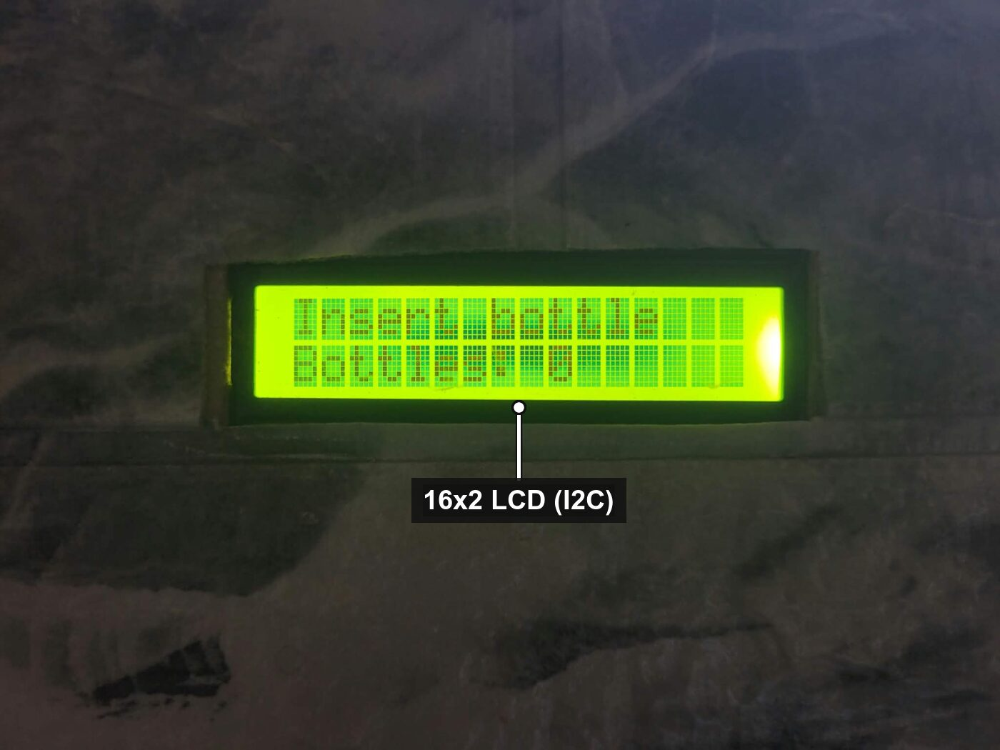
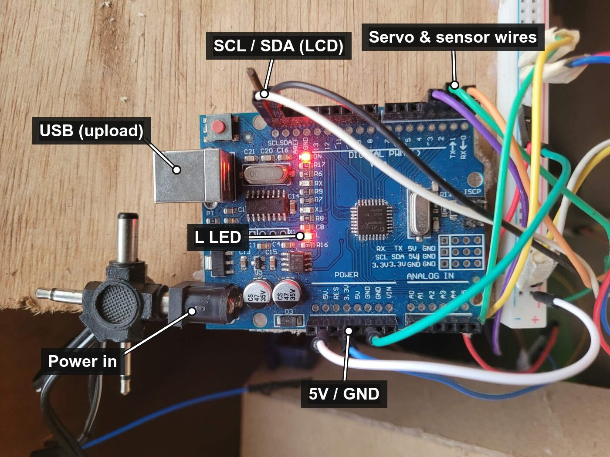

# Bottle Recycler

An Arduino machine that gives a coin for every plastic bottle. A TCRT5000 sensor detects the bottle, one servo takes the bottle in, and a second servo pushes a coin out. A 16x2 I2C LCD tells the user what to do.

| Front | Inside |
|:---:|:---:|
|  |  |

| Screen | Arduino |
|:---:|:---:|
|  |  |

*These two photos were taken with an earlier version of the code. The screen now says "Insert a bottle / to get a coin", and the L LED only lights up if the screen isn't found.*

## How it works

1. The LCD shows **"Insert a bottle / to get a coin"**.
2. The TCRT5000 sensor sees the bottle (even one rolling past quickly).
3. Servo 2 opens the bottle flap (0° → 90° → 0°), then the machine checks that the bottle has left the sensor. If it hasn't, it tries again, up to 3 times.
4. Only once the bottle is in, servo 1 turns 0° → 180° → 0° to push one coin out.
5. The LCD shows **"Thank you! / Take your coin"**.
6. If the bottle never goes in, the LCD shows **"Bottle is stuck / Please remove it"** and no coin is given.

### Reliability

- **Power cuts:** the machine saves what it's doing in EEPROM. If the power goes off after a bottle went in but before its coin came out, the coin comes out when it starts again. A cut after the coin is out can't pay a second one.
- **Servo position:** each servo's angle is saved too, so after a power cut it moves back to 0° without swinging forward (which would push out an extra coin).
- **Screen problems:** if the LCD stops answering, the machine keeps working, tries to restart the screen, and turns on the Arduino's onboard LED (L).
- **I2C freeze:** a timeout stops noise on the LCD wires from freezing the Arduino.

### Limits

- The sensor can't tell a bottle from a hand, so a hand waved in front of it gets a coin.
- The machine can't tell if the coin holder is empty.

## Parts

- Arduino Uno
- 2 × hobby servo (SG90 / MG90S / MG996R)
- TCRT5000 reflective sensor module
- 16x2 LCD with I2C backpack
- 12V power adapter (1A for small servos, 2A for MG996R)
- LM2596 buck (step-down) converter, set to 5.0–5.2V
- 1000 µF capacitor (10V or higher)

## Wiring

| Part | Connects to |
|---|---|
| Servo 1 (coin) signal | D2 |
| Servo 2 (bottle) signal | D3 |
| TCRT5000 D0 | D4 |
| LCD SDA / SCL | Uno pins labeled SDA / SCL |
| LCD and TCRT5000 VCC / GND | Arduino 5V / GND |

### Power

```
12V adapter (+) ──┬──> Arduino barrel jack (or VIN)       → powers Arduino, LCD, sensor
                  └──> Buck IN+
12V adapter (−) ──┬──> Arduino GND
                  └──> Buck IN−

Buck OUT+ (5V) ───> Servo 1 red + Servo 2 red
Buck OUT− ────────> Servo 1 brown + Servo 2 brown + Arduino GND
1000 µF capacitor across Buck OUT+ / OUT− (stripe to −)
```

> ⚠️ Set the buck converter to 5.0–5.2V with a multimeter **before** connecting the servos. 12V will destroy them. Never connect 12V to the Arduino's 5V pin.

The servos must not be powered from the Arduino's 5V pin. They pull too much current, which makes the LCD flicker and the Arduino reset.

## Libraries

- **Servo** (comes with the Arduino IDE)
- **hd44780** by Bill Perry (install from the Library Manager). It finds the LCD's I2C address automatically.

## Uploading

The Arduino IDE needs the folder to have the same name as the `.ino` file, so download it into a folder called `bottle_recycler`:

```sh
git clone https://github.com/adam-ctrlc/bottle-recycler.git bottle_recycler
```

If you use **Code → Download ZIP** instead, rename the unzipped folder to `bottle_recycler`.

Then open `bottle_recycler.ino` in the Arduino IDE, choose **Arduino Uno**, and click Upload.

Or with `arduino-cli`, from inside the folder:

```sh
arduino-cli lib install hd44780
arduino-cli compile --fqbn arduino:avr:uno .
arduino-cli upload -p <your-port> --fqbn arduino:avr:uno .
```

## Files

| File | What's in it |
|---|---|
| `bottle_recycler.ino` | Main program and the LCD messages |
| `config.h` | **All pins, angles and timings — change settings here** |
| `display.h/.cpp` | LCD |
| `sensor.h/.cpp` | TCRT5000 bottle sensor |
| `servos.h/.cpp` | Coin servo and bottle servo |
| `test/` | Simulation that runs the sketch on a computer (see below) |

## Tests

`test/` runs the real sketch code on your computer with fake servos, sensor, EEPROM and LCD, and checks that the machine pays exactly the right number of coins in 12 situations: a bottle rolling past fast, a clear bottle flickering the sensor, a stuck bottle, a retry that frees it, power cuts at each step, leftover EEPROM data, a second bottle during "Thank you!", a missing LCD, and doing nothing.

```sh
sh test/run.sh
```

Needs a C++ compiler (on a Mac: `xcode-select --install`). The Arduino IDE ignores this folder, so it doesn't affect the sketch.

## Troubleshooting

| Problem | Fix |
|---|---|
| Sensor triggers with no bottle, or never triggers | Turn the small screw on the TCRT5000 module. Its LED lights when it sees something. If it works backwards, set `SENSOR_DETECTED = HIGH` in `config.h`. |
| Fast bottles are missed | Mount the sensor 2–10 mm from where the bottle passes. Lower `MIN_DETECT_TIME` in `config.h`. |
| LCD flickers / servos don't move | Power problem. Use the buck converter wiring above. |
| LCD lights up but shows no text | Turn the contrast screw on the back of the LCD. |
| LCD stays dark and the onboard LED (L) is on | LCD not found. Check the SDA, SCL, VCC and GND wires. The machine still works without it. |
| "Bottle is stuck" with no bottle there | The sensor is seeing the background. Turn its screw to make it less sensitive. |
